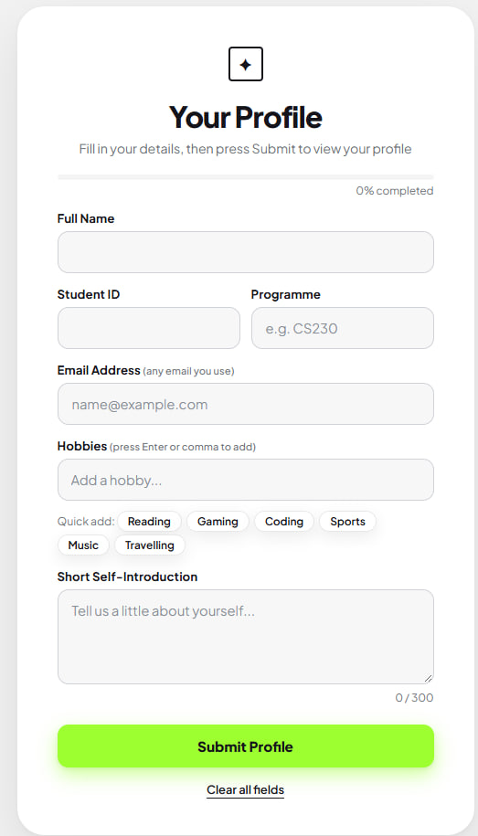
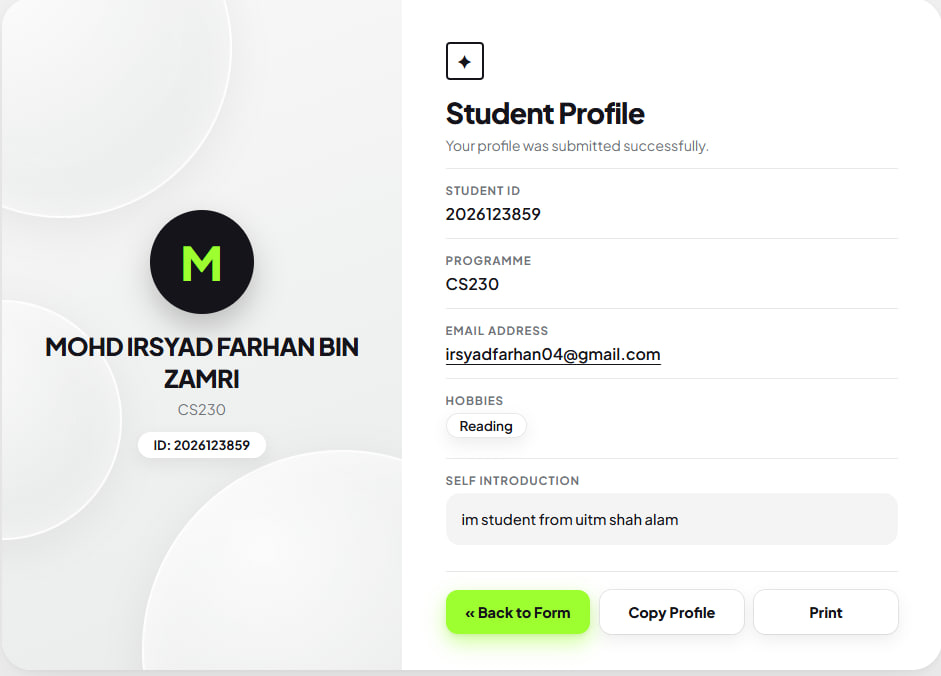

# CSC584 - Individual Assignment 1: Personal Profile Web Application

A simple Personal Profile web application built with **HTML, Java Servlet and JavaServer Pages (JSP)**.
The user fills in a form, the data is sent to a Servlet using **HTTP POST**, and the Servlet passes it to a JSP page that displays the profile.

**Data flow:** `index.html` (Form) &rarr; `ProfileServlet` (HTTP POST) &rarr; `display_profile.jsp`

## Features
- HTML form with labelled fields: Full Name, Student ID, Programme, Email, Hobbies, Short Self-Introduction
- Form validation: Full Name accepts letters and spaces only, Student ID accepts numbers only (8-12 digits), valid email required, at least one hobby
- Hobbies are entered as tags (press Enter or comma)
- Servlet receives the values with `method="post"` and forwards them to the JSP
- JSP displays all submitted information clearly (hobbies shown as tags) with Back, Copy Profile and Print buttons
- Responsive, clean white layout with CSS (and simple JavaScript)

## Technologies Used
- HTML5, CSS3, JavaScript
- Java Servlet and JavaServer Pages (JSP)
- Java JDK 8
- GlassFish Server 4.1.1
- NetBeans IDE 8.2

## Project Structure
```
CSC584-Individual-Assignment-1
├── build.xml
├── nbproject/            (NetBeans project configuration)
├── src/java/             ProfileServlet.java
├── web/
│   ├── index.html        (form)
│   ├── display_profile.jsp (profile display)
│   └── WEB-INF/
└── screenshots/
```

## Required Software
- JDK 8
- NetBeans IDE 8.2 (Java EE / Java Web)
- GlassFish Server 4.1.1 (comes with NetBeans "All" / Java EE bundle)

## How to Run
1. Clone or download this repository.
2. Open **NetBeans** &rarr; **File &rarr; Open Project** and select the project folder `CSC584-Individual-Assignment-1`.
3. Make sure the server is set to **GlassFish Server 4.1.1** (Right-click project &rarr; Properties &rarr; Run).
4. Right-click the project and choose **Clean and Build**, then **Run**.
5. The browser opens the form page. If it does not, go to:
   `http://localhost:8080/CSC584-Individual-Assignment-1/`
6. Fill in the form and click **Submit Profile** to view the profile page.

## Screenshots
| Form | Profile Output |
|------|----------------|
|  |  |

## Author
- Name: Mohd Irsyad Farhan bin Zamri
- Student ID: 2026123859
- Programme: CS230
- Course: CSC584
